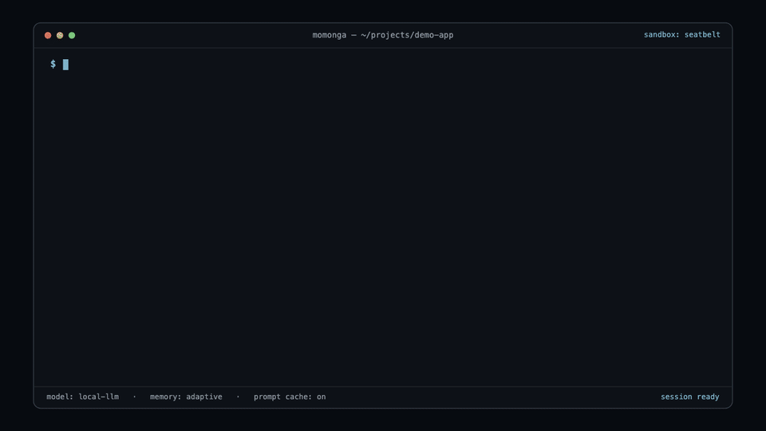

# MomongaCode

MomongaCode is a coding agent for the terminal. It works with local and hosted models, keeps its own memory of your repositories, and runs tool calls under a permission system and an operating-system sandbox. The command is `momonga`.



## 1. Installation

macOS and Linux:

```sh
curl -fsSL https://momongacode.com/install.sh | bash
```

Windows, in PowerShell:

```powershell
irm https://momongacode.com/install.ps1 | iex
```

Then add a model and run a first prompt, as [Getting Started](#3-getting-started) shows.

## 2. Why MomongaCode?

MomongaCode focuses deeply on four engineering problems that decide whether a terminal coding agent stays accurate, clear, and affordable over long sessions:

- **Adaptive Agent Memory & Context Orchestration**
- **Agent Token Efficiency Engineering**
- **Capability-Aware System Prompt Architecture**
- **Output Clarity Engineering**

### Adaptive Agent Memory & Context Orchestration

In MomongaCode, memory and context are built by the runtime from recorded events, not left to the model alone.

- **Structured, evidence-backed memories.** Every memory has a kind (`fact`, `episode`, or `procedure`), a scope (`user` or `project`), and a lifecycle state (`active`, `candidate`, `archived`, `duplicate`, or `rejected`). You can attach evidence—a file with its SHA-256 hash, a commit, or a check—and any memory bound to a file is automatically flagged as stale when that file changes. When a memory is recalled in a later run, MomongaCode shows its freshness (`verified`/`stale`) alongside its bound file paths and short commit SHA inline in the terminal UI, and includes them in the recalled context and `MemorySearch` results.
- **Human review and automatic decay.** Memories proposed by the agent sit in a review queue until you accept or reject them. Duplicates are flagged, replaced notes keep their full history, and active memories with stale file evidence or no bound file are archived after `memory.forgetAfterDays` without being kept or used (default: `90`).
- **Adaptive memory budget.** Every 20 runs in a folder, MomongaCode adjusts how much of the context budget goes to memories based on actual usage: halved if fewer than 25% of injected memories were used, doubled if more than 75% were used and memories had to be dropped (clamped between 1/16 and 1/2 of the budget, starting at 1/4). On by default; turn off with `context.adaptiveBudget: false`.
- **Budgeted context and searchable history.** Each model request is assembled under an explicit token budget from instruction files, rules, memories, active skills, and session history. When older history is compacted, the summary is checked against the content it replaces, and the agent can still look up earlier turns via `HistorySearch` and `HistoryRead`.
- **Enforced standing rules.** Standing rules (`/rule` or `momonga rule`) apply to a single folder or globally. Rules added with `--deny` or `--ask` are enforced by the permission system—not just pasted into the prompt.
- **Benchmarked compaction improvements.** `/context improve` (or `momonga context improve`) generates candidate compaction guidelines, benchmarks them against your current guideline, and writes the results to a file. Nothing takes effect until you explicitly adopt a winner with `/context guideline adopt` (or `momonga context guideline adopt`).

### Agent Token Efficiency Engineering

Every token-saving mechanism is on by default; each has a setting only so you can turn it off, and `momonga eval` measures it against a base with it off.

| Mechanism | Default | Turn off / configure | What it does |
| --- | --- | --- | --- |
| **Prompt cache** | On | `context.cachePrefix: false` | Keeps the leading request prefix stable across turns so provider prompt caches hit reliably, and reports a notice if fewer leading items are preserved than expected. |
| **Tool deferral** | On | `tools.deferral: false` | After 20 runs in a folder, replaces tools never called in the last 20 runs with a one-line catalog and `LoadTools`; full schemas are sent only when loaded. |
| **Concise tool descriptions** | On | `tools.conciseDescriptions: false` | Sends concise tool descriptions to reduce fixed per-turn token overhead. |
| **Output formatters** | On | `context.outputFormatters` | Built-in formatters (`log`, `json`, `grep`, `identicalOutput`) trim noisy tool output before it enters context. List a subset to narrow, or `[]` to disable all. |
| **Loop guidance** | On | `context.loopGuidance: false` | Detects repeated identical tool calls and warns the model—showing the repeated call and prior failing commands—before halting the run. |
| **Observed capacity** | On | `context.observedCapacity: false` | Tracks effective context capacity from real responses. |

**Cost visibility & evaluation:**

| Command | Purpose |
| --- | --- |
| `/cost --breakdown`, `momonga cost --breakdown` | Inspect request composition, billed tokens by category, cache hit rate, timing, and cost. |
| `momonga eval context <dataset>` | Run a golden dataset and report context-efficiency metrics. |
| `momonga eval compare` | Compare `<baseline>` and `<candidate>` with `--gate token` against a baseline using `--settings` with `packages/eval/policies/core-off.json` (all core optimizations off). |
| `momonga eval yield <dataset>` | Run paired sessions (`--model <model>`, `--report <file>`) to measure whether reflection pays for itself, comparing downstream savings against reflection cost. |

All of these optimizations are on by default and can be toggled individually (see [Configuration](#6-configuration)).

### Capability-Aware System Prompt Architecture

MomongaCode builds its system prompt from three deterministic tiers—never hardcoded per model name—so every model gets concise, cache-friendly, capability-matched instructions.

- **Three-tier modular assembly for prompt caching.** An immutable core tier comes first (preserving the longest provider cache prefix across turns and folders), followed by active tool guidelines and capability-driven execution rules, with session-specific environment and data-boundary details placed last.
- **Explicit four-tier instruction hierarchy.** System safety and truthfulness rules come first, followed by the user's direct messages, developer instructions (closest `AGENTS.md` over parent and user `AGENTS.md`), and external data (tool outputs, attached files, user shell outputs, and MCP content—always fenced as data, never instructions).
- **Five core behavioral principles.** Evidence first (inspect before editing; never claim unverified work), root cause first (diagnose failures and refusals instead of retrying blindly), minimal scope, verify changes, and handle uncertainty without guessing.
- **Data-driven adaptation without model-name branches.** Parallel read guidance is injected only when `parallelToolCalls` is measured as supported; step-by-step vs. goal-focused execution guidance adapts from configured `effort`; concise phrasing activates automatically for small context windows or when `tools.conciseDescriptions` is enabled; guidelines for inactive or denied tools are omitted completely.
- **Constraint-aware auditing.** `packages/eval` audits the prompt matrix against explicit constraints—token budgets, four-tier precedence, zero inactive-tool leakage, capability alignment, and stable cache prefixes—so additions cannot bloat or contradict existing rules.

### Output Clarity Engineering

MomongaCode separates everyday terminal responses from high-stakes technical documents, optimizing everyday replies at zero extra latency while offering bounded, codebase-verified revision on demand.

- **Everyday Edit Policy and `/style`.** Every response follows a built-in Edit Policy: match length to the weight of the ask, drop filler and visible-action narration, separate verified facts from inferences, cite exact file paths, and never invent facts absent from code or user input. Switch between `standard`, `concise`, and `explanatory` with `/style [standard|concise|explanatory] [--session] | reset` (stored under `output.style` unless `--session` is passed).
- **Bounded document revision with `/polish`.** Run `/polish [<file>] [--audience <reader>]` to polish the previous assistant response or a chosen file for a specific reader (default: repository developers). Instead of fragile numeric scores, the workflow identifies concrete defects (`undefined_term`, `missing_context`, `logical_gap`, `vague_action`, `excessive_abstraction`), checks technical claims against the actual codebase via read-only tools, applies localized edits only to high/medium defects within a hard two-iteration bound, lists unresolvable gaps as unresolved items rather than guessing, and applies file changes through the normal confirmation flow.

## 3. Getting Started

Run `momonga` to open an interactive session and connect a model with `/login` and `/model`, or configure one from the command line using one of the three options below. Any command that needs the background daemon starts it automatically; check its state with `momonga daemon status`.

### A model server on this computer

1. Start a local model server (such as Ollama) and scan for available servers and models. This makes no changes:

   ```sh
   momonga models detect
   ```

2. Add a listed model using the exact name the server reports (omit `--yes` to preview the change first):

   ```sh
   momonga models add --address http://127.0.0.1:11434 --model <own name> --yes
   ```

   Ollama reports each model's context window and tool support automatically, so `--window` is not required. If a server does not report its context window—or nothing responds at the address—the command tells you without writing anything; pass `--window <tokens>` explicitly when needed.

3. Verify the configured models:

   ```sh
   momonga models
   ```

### A subscription account

1. Sign in via your browser (or via your local `claude` CLI login for Claude Code). Built-in providers are `chatgpt`, `grok`, and `claude-code`:

   ```sh
   momonga auth login chatgpt
   # or
   momonga auth login grok
   # or (uses your local `claude auth login` session)
   momonga auth login claude-code
   ```

   Running `momonga auth login` without an argument lets you choose interactively in a terminal. A newly linked account has no model configured yet; the login flow prints the next step, and `momonga auth status` shows all saved accounts and their status.

2. List the models available on the account and add one by its own name:

   ```sh
   momonga models catalog <account>
   momonga models add --plan <provider> --account <account> --model <own name> --yes
   ```

Inside an interactive session, use `/login` to sign in and `/model` to switch models. Sign-in is never triggered automatically while typing on the start screen—only when you explicitly run `/login` or `momonga auth login`.

### An API key

1. Store your API key in the OS secret store under a name of your choice. The key is read interactively from the terminal and never written to settings files:

   ```sh
   momonga secret set <name>
   ```

2. Register the model and point it at the stored secret:

   ```sh
   momonga models add --address <url> --api <api> --model <own name> --api-key-secret <name> --yes
   ```

   Use `--api` (`ollama`, `openai`, `anthropic`, or `responses`) when MomongaCode cannot detect the server's protocol automatically. To read the key from an environment variable instead of the secret store, pass `--api-key-env <NAME>` (the variable must be present in the environment when the daemon starts).

> **Note on metered models:** Pay-per-use models are never probed without your consent. The first probe request stops and tells you the maximum requests, input tokens, and output tokens it may send, along with the command to approve it. That consent is saved for that model and bound.

### The first prompt

Open the interactive session in your repository:

```sh
cd your-repository
momonga
```

Type a request at the prompt and press Enter. A line that starts with `/` is a command to the session instead: typing `/` lists the commands that match what you have typed, `/help` lists every command and key, `/model` switches the model, `/mode` changes the permission mode, `/clear` starts a new session, and `/exit` leaves. [Interactive session](#interactive-session) describes the commands you will use most, and [the reference](docs/reference.md#slash-commands) lists them all.

To run one prompt without the terminal UI, for example from a script:

```sh
momonga -p "explain what this repository does"
```

The first time you open an interactive session in a folder, MomongaCode asks whether you trust it. Until a folder is trusted, project-level settings—and anything they could execute—are ignored. Non-interactive commands (`momonga -p`, `momonga attach`, and editors over `momonga acp`) still run without project settings and print a one-line notice referencing `momonga trust <folder>`. To trust the current folder from the shell, run `momonga trust --set trusted`.

## 4. Features

### Interface, models & tools

- **Terminal UI and headless mode.** Work interactively in the terminal and control the session with slash commands (see [Interactive session](#interactive-session)), or script runs with `-p`/`--print` and `--output-format text|json|stream-json`.
- **Models.** Connect to Ollama, OpenAI chat-completions, Open Responses, Anthropic, or managed local servers that MomongaCode starts on demand (such as Apple's `fm`). Every model is referenced by the name its server reports. Switch models in the session with `/model`, configure `models.fallback` to fail over when a server cannot answer, and run `/gateway probe <model>` (or `momonga gateway probe <model>`) to measure and cache a model's capabilities.
- **Built-in tools.** Includes `Bash` (plus `BashOutput` and `KillBash` for background commands), `Read`, `Write`, `Edit`, `Glob`, `Grep`, `ReadOutput`, `UpdatePlan`, `MemorySave`, `MemorySearch`, `HistorySearch`, `HistoryRead`, `RulePropose`, `Agent` (with a built-in `general-purpose` subagent ready out of the box), `LoadTools`, `activate_skill`, and dedicated Git/PR/issue tools (`GitStage`, `GitCommit`, `GitPush`, and more) that clearly declare what they modify before asking for approval. See [the reference](docs/reference.md) for the full list.
- **Output styles and bounded polish.** Switch everyday reply density with `/style [standard|concise|explanatory] [--session] | reset` (`output.style`), or run `/polish [<file>] [--audience <reader>]` for bounded, codebase-verified revision of long responses and technical docs.

### Safety, permissions & verification

- **Permission modes.** Controls how MomongaCode handles tool calls that no explicit rule matches. In every mode, deny rules still block calls, secret locations stay protected (see [Permission rules](#permission-rules)), and workspace-deletion commands still ask unless `bypassPermissions` is active. Define rules as `Tool(specifier)` in `permissions.allow`, `permissions.ask`, and `permissions.deny` ([Configuration](#6-configuration)), switch the mode in the session with `/mode`, change the rules with `/permissions`, and resolve pending approvals from the shell with `momonga approve` (`allow_once`, `allow_always`, `reject_once`, or `reject_always`).

| Mode | Workspace edits | Commands & network | Best for |
| --- | --- | --- | --- |
| `manual` | Asks | Asks | Maximum control over every action |
| `acceptEdits` | Auto-allowed | Asks | Fast iterative coding inside a repo |
| `plan` | Blocked | Read-only only (asks otherwise) | Codebase exploration and planning |
| `auto` | Classifier decides | Classifier decides | Hands-off work with classifier guardrails |
| `bypassPermissions` | Auto-allowed | Auto-allowed | Isolated sandboxes only (deny rules still hold) |

- **Policy verification.** Run `/policy verify` in the session or `momonga policy verify` from the shell to have the daemon formally check your folder's rules: ensuring no allow rule bypasses a deny rule, no rule exposes secret paths, and every rule is reachable. It reports what is proved and what is not, and lists redundant, shadowed, or unreachable rules as non-blocking notes. The verdict is stored with the folder's rules and reused by subsequent runs until a rule changes.
- **Verifiable completion.** Attach shell-command completion conditions that MomongaCode runs itself inside the sandbox after the model finishes. A run reaches `COMPLETED` only if every required condition passes on the final workspace state; otherwise failures are sent back to the model, and stopping again without changes ends as `STOPPED` (`conditions_unmet`). Inspect results with `/report` or `momonga report` (see [Usage](#5-usage)).
- **Auto mode.** Evaluate how reliably a classifier model judges approvals with `/auto-mode` or `momonga auto-mode`. Auto mode can only be enabled from user settings or CLI flags—never from project settings.
- **Sandbox.** `Bash` commands run inside Seatbelt on macOS and bubblewrap on Linux. Windows does not yet have a sandbox in this release, so `Bash` prompts before every command there.

### Memory, extensions & editor integration

- **Memory and rules.** Manage project/user memories with `/memory` and standing rules with `/rule` in the session, or with `momonga memory` and `momonga rule` from the shell (see [Why MomongaCode?](#2-why-momongacode)).
- **Skills and agents.** Load `SKILL.md` skills from `.momonga/skills`, `.agents/skills`, `~/.momonga/skills`, and `~/.agents/skills`. A `general-purpose` subagent is built in. Custom agents are loaded from `.momonga/agents` directories (project and user), and a custom agent named `general-purpose` replaces the built-in one. Set `models.roles.subagent` (via `momonga models role set` with job `subagent`, or `/model` → `Model settings…` → `Models for other roles`) to run model-less subagents—including `general-purpose`—on another configured model (same or different provider), while any `model:` in an agent file (including `model: inherit`) takes precedence. Project skills load only in trusted folders. Each skill is a slash command, `/<skill> <request>`; `/skills` and `/agents` list the files, open one in your editor, or create one from a template.
- **MCP.** Connect to MCP servers over stdio or HTTP (with OAuth). Show, add, remove and authorize servers with `/mcp` in the session, or with `momonga mcp list` and `momonga mcp login <server>` from the shell, and answer pending MCP input prompts with `momonga elicit`.
- **Hooks.** Run shell hooks on `PreToolUse`, `PostToolUse`, `UserPromptSubmit`, `Stop`, and `SessionStart`. A hook that exits with code `2` blocks the action. `/hooks` shows the hooks by event and adds, edits or removes one.
- **Editor integration.** Run `momonga acp` to expose MomongaCode over stdio using the Agent Client Protocol.

### Observability, delegation & reliability

- **Observability.** Inspect model and tool spans with `/trace` or `momonga trace`, review token spend with `/cost` or `momonga cost`, or export traces to an OTLP endpoint via `telemetry.otlp`.
- **Background jobs and runs.** Monitor active work with `/status` and `/jobs` in the session, or with `momonga status`, `momonga jobs`, `momonga attach`, and `momonga cancel` from the shell.
- **Delegated work.** Hand off bounded runs using named mandates via `momonga -p --mandate <name>` or `/delegate <mandate> <request>` in the interactive UI (see [Usage](#5-usage)).
- **Measured reliability.** Track completion and failure rates with `/reliability` or `momonga reliability`, run reproducible bench suites with `momonga eval bench <folder>`, and audit past approval decisions with `momonga permissions review` (see [Usage](#5-usage)).

## 5. Usage

### Interactive session

`momonga` with no prompt opens the interactive session, where most work happens. Type a request and press Enter; a line that starts with `/` runs a command of the session. Typing `/` lists the commands that match what you have typed, and `/help` lists every command with the keys. The commands you will use most:

**Session**

| Command | What it does |
| --- | --- |
| `/clear` | Start a new session; the current one stays reopenable with `/resume`. |
| `/resume [session-id]` | Reopen an earlier session of this folder, or choose one from a list. |
| `/compact [instructions]` | Run compaction on the session now; the text after the command is what the summary should focus on. |
| `/copy` | Copy the selected text, or the last answer when nothing is selected. |
| `/exit` | Leave; a run that is working continues in the daemon. |

**Model and behaviour**

| Command | What it does |
| --- | --- |
| `/login [provider]` | Connect a model: sign in to a subscription or add an API key. |
| `/model [model] [effort] [--start]` | Choose the model from a list, or switch to another; `--start` also makes new sessions start with it. |
| `/effort` | Choose the reasoning effort of the model. |
| `/mode [mode] [--start]` | Choose the permission mode (`manual`, `acceptEdits`, `plan`, `auto`, `bypassPermissions`). |
| `/style` | Choose the output style: `standard`, `concise` or `explanatory`. |
| `/polish [<file>] [--audience <reader>]` | Revise the last answer or a file for a reader, checked against the code. |

**Memory, rules and skills**

| Command | What it does |
| --- | --- |
| `/init` | Create `AGENTS.md` from what the repository shows, or improve the one it has. |
| `/memory` | List, add, review, restore, promote or retire memories; `/memory review` shows the ones the agent proposed. |
| `/rule` | List, add or retire the standing rules of this folder. |
| `/skills`, `/agents` | List the skill and agent files, open one in your editor, or create one from a template. |
| `/<skill> <request>` | Run a request with a skill of the folder activated. |

**Settings and safety**

| Command | What it does |
| --- | --- |
| `/config` | Open the settings screen. |
| `/permissions` | Show and change the start mode, the allow, ask and deny rules, the additional folders and the trust of this folder. |
| `/policy verify` | Check that no allow rule gets around a deny rule and that no rule leaves a route to secrets. |
| `/mcp` | Show the MCP servers with their status, add or remove one, or authorize one. |
| `/hooks` | Show the hooks by event and add, edit or remove one. |
| `/keybindings`, `/theme`, `/tui` | Change the keys, the colours and the screen mode. |

**Runs and cost**

| Command | What it does |
| --- | --- |
| `/status`, `/jobs` | Show a run with its subagents and the approvals waiting in them, and the background jobs of the session. |
| `/report [run-id]` | Show the verification report of a run: what passed, failed or was not run. |
| `/cost [--breakdown]` | Show the model cost of a run, a session or this folder. |
| `/trace [run-id]` | Show the model and tool spans of a run. |
| `/delegate <mandate> <request>` | Hand a request over under a mandate of your settings. |

[Slash commands](docs/reference.md#slash-commands) in the reference lists every command with its arguments and subcommands. To view or edit model settings, open `/model` and choose `Model settings…`, or open `Models` inside `/config`.

### Command line

```text
momonga [options] [prompt]
```

The `momonga` subcommands work from the shell without the terminal UI, for scripts, CI and editors; several of them, such as `momonga memory`, `momonga report` and `momonga cost`, are also slash commands of the same name in the session. [The reference](docs/reference.md) documents every CLI option, subcommand, settings key, environment variable, and exit code directly from the product's own tables. You can also run `momonga <command> --help` for any subcommand.

### Updating MomongaCode

- **Manual updates.** Run `momonga update` to download and replace the executable after verifying its checksum and signature, or `momonga update --check` to see if a newer release is available without installing.
- **Zero-interruption daemon handover.** Updates never abort active work. If a daemon is running, the update starts a new-version daemon alongside it to handle new requests immediately. The previous daemon stops accepting new work, finishes in-flight steps and background jobs, and exits cleanly (`momonga daemon status` shows it as retiring). Existing interactive sessions stay connected until the old daemon finishes, then prompt you to reopen. If the new daemon fails to start, the new version stays installed, the old daemon keeps running, and the message prints what to run.
- **Stopping work explicitly.** `momonga daemon stop` is the only command that interrupts running work; it stops every running daemon and prints the count of active steps and background jobs it is stopping.
- **Automatic background checks.** Release builds check for updates in a detached background process at most once every 24 hours (never for source builds). When a newer release is found, it verifies the signed checksum list, the executable's SHA-256, and (where pinned) the Apple Developer ID signature, then runs `--version` on the new binary before swapping it in. If any check fails, nothing is changed. On your next command, MomongaCode prints a one-line notice of the update or failure. Disable automatic checks with `"autoUpdates": false` in your user settings (ignored in project settings).

### Delegated work

- **Mandates.** A mandate is a named grant in your user settings under `mandates` (never read from project settings). It specifies extra permission rules (`allow`, `ask`, `deny`), completion conditions (`until`, `require`), and hard budgets (`steps`, `tokens`, `costUsd`, `timeMs`, `retries`). Start a mandated run with `momonga -p --mandate <name> "<request>"` or `/delegate <mandate> <request>`. When a run is created, the daemon verifies the combined folder and mandate rules and refuses the run if any allow rule circumvents a deny rule. Calls requiring approval pause only that call while independent work continues; `onQuiescent` controls whether the run waits for approval (`wait`) or finishes with a report (`report`).
- **Forges and Git operations.** Remote Git, pull request, and issue tools (`GitPush`, `GitFetch`, and PR/issue tools) only talk to forges explicitly declared under `forges` (each defining `id`, `descriptor`, `hosts`, `apiBaseUrl`, and `credential.env` or `credential.secret`). SSH remotes on a declared forge are routed over that forge's HTTPS URL using its credential, and undeclared remotes are refused with instructions on what to add. Git processes started for these tools never load hooks, credential helpers, or proxy programs from the repository.
- **Issue automation.** Run `momonga -p --issue <address> --mandate <name>` to resolve a single issue on a declared forge, open a closing pull request, and post a comment on the issue. For continuous polling, configure `issues.watch` in user settings: every 5 minutes, MomongaCode checks each declared forge for open issues matching the entry's `labels` and `authorAssociation` filters and starts one run per new issue in its `folder` under its `mandate`. Entries with neither filter match nothing, and pull requests are never picked up.
- **Run budgets.** Every run is bounded. Without a custom budget, runs stop at 50 steps or 1,000,000 tokens. Set a spend budget with `--max-cost-usd <usd>` on `momonga -p` or `limits.maxCostUsd` in user settings to halt before any model call that would exceed the limit; mandates enforce their own budgets.

### Verification and reports

| Command | What it does |
| --- | --- |
| `momonga reliability` | Summarize run outcomes over a period (completed, recovered, repeated work, human interventions, budget hits, time, and cost) grouped by model, mode, agent, origin, or period (`--json`, `--out <file>`). |
| `momonga eval bench <folder>` | Execute every bench case in `<folder>` against one model in fresh repo copies and score each with its oracle. Compare reports with `momonga eval compare <baseline> <candidate> --gate reliability`. |
| `momonga permissions review` | Sample recorded tool calls (auto-allowed and prompted) and record your audit label (`--label correct`, `unneeded_ask`, or `missed_ask`). |

If a run fails its completion conditions, it stops (`STOPPED`) rather than silently escalating to a stronger model.

### Verifiable completion

Completion conditions are fixed when a run starts and come from the union of three sources:

1. **The request:** `--until` and `--require` flags on `momonga -p`, or a mandate passed by an ACP client or bench task.
2. **The agent definition:** `conditions` and `requirements` in a custom agent's front matter (set `inherit: false` on a request or agent to use only its own conditions).
3. **Settings and project checks:** Commands listed in `verification.commands` plus any folder check you accepted. These apply only when a run edits the workspace—read-only questions do not trigger test suites. By default, `verification.commands` is empty.

**How checks run:**
- Once the model stops, MomongaCode executes every owed condition itself. A command the model ran during its own turn never counts as proof, even if it exited `0`.
- If a check fails and the workspace changed since the last failed round, the failures are returned to the model to fix. If the model stops again without making changes, the run ends `STOPPED` with reason `conditions_unmet`.
- Each check is capped at its declared timeout (default: 600 seconds). If a condition matches a `deny` rule, the run is refused at creation time.
- With `"verification": { "required": true }`, any run that edits the workspace without a declared condition also ends `conditions_unmet` (`verification.required` is `false` by default; when `false`, such runs finish unverified, learn no memories, and print a notice explaining how to declare a check).

**Inspecting reports and folder checks:**
- The interactive session, `--print`, and ACP show each check as it runs and name any unmet conditions when the run ends.
- Use `momonga report [run-id]` (or `/report` interactively) to view every condition's status and exit code, what was not run and why, modified files, residual risk facts, and matching commands the model ran on its own (informational).
- When you start an interactive session in a trusted folder that defines a test command (a `test` script in `package.json`, or a `test` rule in a `Makefile` or `justfile`), MomongaCode proposes it once as the folder's standing check and saves your choice under `projectChecks` in user settings. View or update it anytime with `/init`, `/config`, or `momonga project-check show`, `set <command>`, and `clear`.

> **Breaking change for folders using `verification.commands`:** Previously, `verification.commands` only told memory which commands counted as verification. They are now enforced completion conditions: after the model stops, MomongaCode runs them on the final workspace state, ends the run as `STOPPED` (`conditions_unmet`) with a non-zero exit code on `momonga -p` if any command fails, and allows a run to propose memories or repository facts only when it declared at least one condition and all of them passed (a passing command the model ran itself no longer counts).

## 6. Configuration

### Settings files

| File | Scope |
| --- | --- |
| `~/.momonga/settings.json` | User settings (all keys allowed) |
| `<project>/.momonga/settings.json` | Project settings (loaded only in trusted folders) |
| `~/.momonga/projects/<hash>/settings.local.json` | Per-project local overrides stored outside the repository |
| `<project>/.mcp.json` | Project MCP servers |

Project and local settings cannot set `models`, `credentials`, `mcp`, `mcpServers`, `sandboxNetwork`, `sandbox`, `sandboxUnixSockets`, `telemetry`, `projectApprovals`, `projectChecks`, `retention`, `network`, `limits`, `ceilings`, `mandates`, `issues`, `forges`, `operations`, `pricing`, `autoUpdates`, `daemon`, `gateway`, `runtime`, or `autoMode`; those keys are discarded with a warning.

They also cannot set `tools.ripgrep`, `tui.screen`, `tui.mouse`, or `tui.copyOnSelect`, and cannot set `permissions.defaultMode` to `bypassPermissions` or `auto`. In `env`, only a small allowlist of variable names is kept. Unknown keys are ignored with a warning.

### Models

**Naming models.** Every model uses the exact name its server reports. Its full name is `server/own-name` (for example, `ollama/devstral-small-2:latest`). If the model name is unique across your configured servers, you can pass just the short name (`--model devstral-small-2`); if two servers expose the same name, use the full name.

**Connections.** Each server or account is an entry in `models.connections` specifying an `adapter` (`ollama`, `chat-completions`, `open-responses`, `anthropic`, or `managed`), its address, and its `models` list (each with an `id` and `capabilities`). The server prefix of the full name comes from `provider`; if omitted, it defaults to `ollama` or `anthropic` for those adapters, the account name for subscriptions, the server program for `managed` connections, or a name derived from the address (such as `srv-127.0.0.1-1234`).

**Credentials.** Keys are always referenced, never stored directly in `settings.json`:

- `apiKeyEnv` — name of an environment variable holding the key.
- `apiKeySecret` — name of an entry in the OS secret store created with `momonga secret set <name>`.
- `anthropic` connections require exactly one of the two; `chat-completions` and `open-responses` accept at most one; `ollama` and `managed` take none.

Example configuration:

```json
{
  "models": {
    "connections": [
      {
        "adapter": "ollama",
        "baseUrl": "http://127.0.0.1:11434",
        "models": [
          { "id": "your-model-name:latest", "capabilities": { "contextWindow": 32768, "maxOutputTokens": 4096 } }
        ]
      },
      {
        "adapter": "chat-completions",
        "provider": "example",
        "baseUrl": "https://api.example.com/v1",
        "apiKeyEnv": "EXAMPLE_API_KEY",
        "models": [
          { "id": "example-model", "capabilities": { "contextWindow": 128000, "maxOutputTokens": 8192 } }
        ]
      }
    ],
    "start": "example/example-model",
    "fallback": ["ollama/your-model-name:latest"],
    "billingChanges": [{ "from": "metered", "to": "local" }]
  },
  "permissions": {
    "defaultMode": "manual",
    "allow": ["Bash(npm test:*)"],
    "deny": ["Bash(rm:*)"]
  }
}
```

**Routing, capabilities, and management:**
- `models.start` picks the default model for new sessions (otherwise the first configured model is used).
- `models.fallback` lists models to try in order when the active model cannot answer. Switching between metered and local billing during fallback is allowed only if permitted by `models.billingChanges`; otherwise MomongaCode shows a warning.
- Set `capabilities` to accurate values for your model, or let `momonga gateway probe <model>` measure and save them.
- A `managed` connection specifies `server`—either the built-in `fm` or a program defined under `models.servers`.
- Additional keys under `models` include `roles` (override models for `compaction`, `reflection`, `analysis`, or `subagent`), `dialects`, `headersTimeoutMs`, and `idleTimeoutMs`. Individual connections also accept `billing`, `maxConcurrency`, and `admissionTimeoutMs`.
- You can manage all of these without hand-editing JSON using `momonga models add`, `remove`, `start`, `fallback`, `billing`, `role`, and `set`, or `/model` → `Model settings…` in an interactive session.

**Double-send risk and idempotency.** A model request can be sent twice—for example, after a crash of the gateway or runtime, or when a server fails or drops the connection before its answer starts—meaning a provider may run and bill it twice. Every resend is recorded as `retry_of`: the usage record includes `retry_of_seq` and the trace span carries `momonga.retry_of` pointing to the first send. If your server supports idempotency keys, set `idempotencyKeyHeader` on its connection (e.g., `"idempotencyKeyHeader": "Idempotency-Key"`) so MomongaCode sends the same key on the initial request and all resends, ensuring the server answers and bills it once. Without that setting, no header is sent. See [the threat model](docs/threat-model.md) for full details.

### Permission rules

**Rule syntax and matching:**
- Write rules as `Tool(specifier)`, or just `Tool` to match every call of that tool. Rules work for every built-in tool (including `Agent`, `LoadTools`, `activate_skill`, and Git/PR tools) and for MCP tools (`mcp__<server>__<tool>` or `mcp__<server>__*`).
- Path specifiers keep parentheses as literal text—`Edit(app/(auth)/**)` matches `app/(auth)/page.tsx`.
- If a rule cannot be parsed when settings load, MomongaCode reports its file, key, and reason while still loading the remaining valid rules.
- Prefix rules such as `Bash(npm test:*)` match only when those words appear consecutively at the start of the command: `git -c core.pager=<program> log` does not match `Bash(git log:*)`, though it does match `Bash(git:*)`. A `*` matches any text (so `Bash(curl *)` matches any `curl` invocation). Dynamically constructed commands that the shell parser cannot analyze are never auto-decided and always ask you.

**Important caveat on `Bash(...)` rules:**
- Like Claude Code, `Bash(...)` allow rules match command text literally without inspecting what flags do. An allow rule therefore also permits options that execute arbitrary subprograms—for example, `npm test --script-shell=<program>` under `Bash(npm test:*)`, `find . -exec <program> {} \;` under `Bash(find:*)`, or `git -c core.pager=<program> log` under `Bash(git:*)`.
- Only allow programs whose full flag set you trust. Pairing a broad allow with a narrower deny works as expected (e.g., allowing `Bash(git:*)` while denying `Bash(git push:*)`). Run `momonga policy verify` to spot redundant, shadowed, or unreachable rules (reported as non-blocking notes).
- Similarly, a `Bash(...)` deny rule (such as `Bash(rm:*)`) checks only the top-level command text and cannot stop an allowed command from launching another program via a flag.

**Sandbox and network controls:**
- Allowed commands still execute inside the OS sandbox: writes are restricted to allowed workspace paths, and file deny rules (`Read(...)`, `Edit(...)`) are enforced by the OS so child processes cannot bypass them either.
- Commands have **no network access by default**, and read-only commands never receive network access.
- To reach the network, the model must declare `network` on the `Bash` call—either `{"hosts": ["registry.example.org"]}` (hostnames or IPs, optionally with `:port`) or `"open"` for unrestricted access—and ask for your approval. Only you can grant it; hooks and the `auto` classifier never do.
- Approvals last for one call. To pre-configure host rules in user settings (never project settings), use `Network(registry.example.org)` or `Network(*.example.org)`. Allow rules never cover `"open"`.
- The `sandboxNetwork` setting sets the default policy (`ask` by default, `deny` to block all network requests, or `allow` to grant without prompting). Override it per session with `--sandbox-network deny|ask|allow` (not configurable from project settings).
- Named-host access goes through a local per-command HTTP/HTTPS proxy started by MomongaCode: it forwards only to granted hosts, closes tunnels whose TLS SNI or HTTP `Host` does not match the granted host, and refuses any hostname that resolves to a loopback, link-local, or private address unless that address itself is granted. Refused hosts appear in the tool result, and tools that ignore proxy env vars (`HTTPS_PROXY`, etc.), such as SSH, stay offline.

**Secrets, approval UI, and `"sandbox": "none"`:**
- Secret paths (`~/.ssh`, `~/.aws`, `~/.netrc`, MomongaCode's home directory, and the OS key store) remain denied to reads and writes in every mode, including `bypassPermissions`. See [the threat model](docs/threat-model.md) for the complete list.
- Approval prompts display the full command (or all MCP/operation arguments) safely escaped against terminal redraw sequences, with the model's own explanation clearly labeled as the model's claim. Any change to arguments or description triggers a fresh prompt. In `/config`, removing a rule or extra folder asks for confirmation and shows which settings file owns it.
- Adding or changing a hook group, mandate file, `.mcp.json` server, or custom agent inside a trusted folder stays inactive until you approve it (`momonga trust` lists pending items).
- With `"sandbox": "none"`, OS filesystem and network bounds are inactive, so `Bash` allow rules no longer skip approval: `Bash` prompts before every command (or defers to the classifier in `auto` mode).

See [the threat model](docs/threat-model.md) for all accepted risks and security boundaries.

### Other settings

- See [the reference](docs/reference.md) for every settings key, its accepted values, and which layers may set it.
- MomongaCode stores its state under `~/.momonga` (settings, `state/` databases, `logs/`, `skills/`, `agents/`, and per-project data).
- Instruction files named `AGENTS.md` are automatically loaded into context.

### Installer options

No configuration is required to install.

The install scripts fetch `SHA256SUMS` and `SHA256SUMS.sig` from the latest GitHub release of `yuuichieguchi/MomongaCode`, verify the signature with `ssh-keygen` against the embedded release public key, check the binary's SHA-256, and abort without installing if any check fails (`ssh-keygen` is required—on Windows, enable the OpenSSH Client optional feature).

Optional environment variables—such as `MOMONGA_VERSION` to pin a release or `MOMONGA_MODIFY_PATH=0` to skip PATH edits—are listed in [the reference](docs/reference.md).

PATH is updated only if the install directory is not already on it (`install.sh` checks the active shell's PATH; `install.ps1` checks the user PATH):

- `install.sh` adds one marked block to your shell config—`.zshrc` (under `ZDOTDIR` if set) for zsh; the first existing of `.bashrc`, `.bash_profile`, or `.profile` (otherwise `.bashrc`) for bash; `~/.config/fish/config.fish` (using `fish_add_path`) for fish; or `~/.profile` for other shells. Re-running updates that block in place. If the directory is already on PATH, nothing is modified.
- `install.ps1` appends the install directory to the user PATH.
- With `MOMONGA_MODIFY_PATH=0`, neither installer edits your shell config and both print the command to run in your current shell instead.

## 7. Architecture

MomongaCode is organized as an npm workspace under `packages/`. The `momonga` CLI is a thin client; execution, policy enforcement, and model I/O run inside background daemon processes.

| Layer | Package | Responsibility |
| --- | --- | --- |
| Client | `packages/cli` | CLI, terminal UI, and ACP editor server; starts and talks to the daemon. |
| Supervisor | `packages/supervisor` | Manages gateway and runtime lifecycles across versioned daemon generations so updates hand over without interrupting active work. Settings are read per operation with no child restart. |
| Runtime | `packages/runtime` | Drives sessions, runs, and the model/tool loop—combining context, policy, tools, sandbox, and persistence. |
| Gateway | `packages/gateway` | Centralizes model traffic across Ollama, chat-completions, Open Responses, and Anthropic adapters (plus routing, retries, admission, probing, and managed servers like Apple's `fm`). |
| Store | `packages/store` | Persists runs, events, approvals, memories, rules, and jobs in databases under `~/.momonga/state`. |
| Context | `packages/context` | Builds budgeted prompts, compacts session history, and formats tool outputs. |
| Memory | `packages/memory` | Handles memory validity checks, recall ranking, deduplication, forgetting, and adaptive budget sizing. |
| Tools & extensions | `packages/tools`, `packages/skills`, `packages/agents`, `packages/mcp` | Built-in tool execution, skill/agent loading, and MCP server connections. |
| Policy | `packages/policy` | Evaluates tool calls against permission rules, parsed shell commands, and affected paths. |
| Sandbox | `packages/sandbox` | Isolates shell commands using Seatbelt (macOS) or bubblewrap (Linux). |
| Configuration | `packages/config` | Defines the settings schema and merges user, project, and local layers. |
| Shared & observability | `packages/protocol`, `packages/foundation`, `packages/observability`, `packages/reliability` | Shared types and wire formats, platform/credential helpers, traces/cost/OTLP export, and reliability reports. |
| Verification & eval | `packages/verify`, `packages/eval`, `packages/testkit` | Formal Z3 rule verification, benchmark/eval runners and comparators, and test fakes. |

Core state machines are formally specified in TLA+ under `specs/tla/` and model-checked with TLC in the test suite.

## 8. Requirements

- **Operating systems.** Installers ship for macOS (Apple silicon, arm64), Linux (x86_64 and aarch64), and Windows (x64). CI runs on macOS, Linux (x86_64), and Windows.
- **Node.js.** Needed only when building or developing from source: `>=24.22.1` (see `engines` in `package.json`; CI tracks `.node-version`).
- **Sandbox.**
  - **macOS:** `sandbox-exec` (Seatbelt).
  - **Linux:** `bwrap` (bubblewrap) with permission to create sandboxes. If unavailable, the runtime refuses to start and instructs you to set `"sandbox": "none"`.
  - **Windows:** No sandbox in this release; `"sandbox": "none"` is the default and `Bash` prompts before every command.
- **Bash.** Requires `/bin/bash` on macOS, `/bin/bash` or `/usr/bin/bash` on Linux, and Git for Windows (`bin\bash.exe` beside `git.exe` on PATH) on Windows.
- **Installers.** `curl` and `ssh-keygen` on macOS and Linux; `ssh-keygen` (OpenSSH Client) on Windows.
- **Model.** A local model server (such as Ollama), Apple's `fm`, or any hosted API with credentials.

## 9. Contributing

Pull requests on GitHub are welcome. See [CONTRIBUTING.md](CONTRIBUTING.md) for source build and test instructions, and [SECURITY.md](SECURITY.md) for reporting vulnerabilities.

## 10. License

MomongaCode is open source under the MIT License; see [`LICENSE`](LICENSE).

Release builds bundle ripgrep (MIT or Unlicense); see [`THIRD-PARTY-NOTICES.md`](THIRD-PARTY-NOTICES.md).

## 11. Disclaimer

MomongaCode is provided "as is", without warranty of any kind. It executes commands and modifies files on your machine, and sends prompts, file contents, and tool outputs to the model servers you configure.

You are responsible for the models, permission rules, sandbox settings, and permission modes you choose, for any hosted model costs, and for reviewing the agent's actions. Models can make mistakes—do not enable `bypassPermissions` or `"sandbox": "none"` on machines or folders where an unintended command could cause irreversible harm.
